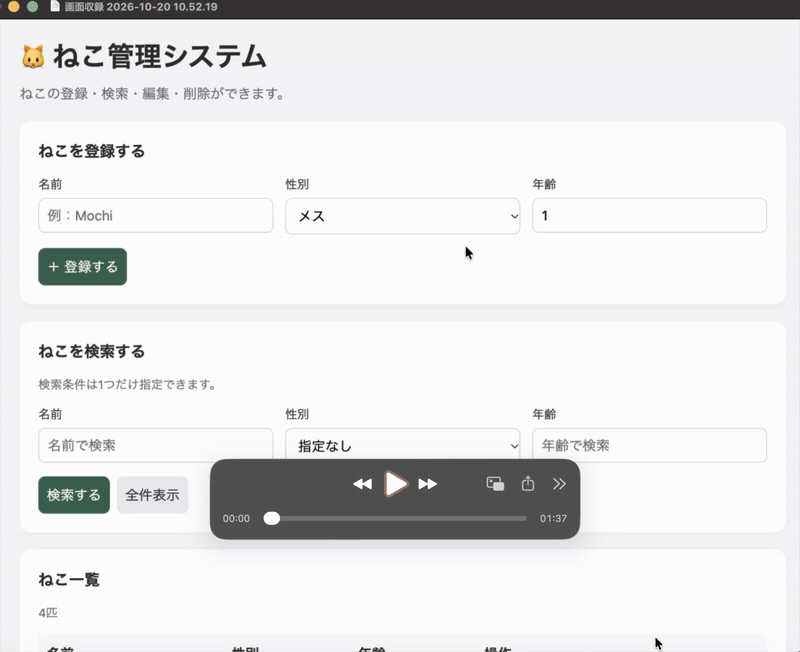

# 🐱 猫管理システム

JavaとSpring Bootを使用して開発した、猫の情報を管理するWebアプリケーションです。

猫の登録・一覧表示・検索・編集・削除の機能を実装し、Renderを利用してWeb上に公開しています。

## アプリの操作デモ



**公開サイト：** https://cat-system-4z91.onrender.com

## 📌 機能一覧

- **猫の登録**：名前・性別・年齢を登録
- **猫の一覧表示**：登録されている猫の情報を一覧で表示
- **猫の検索**：名前・性別・年齢で検索
- **猫の情報編集**：登録済みの猫の情報を更新
- **猫の削除**：登録済みの猫の情報を削除

## 🛠 使用技術

| 分類           | 技術           |
|--------------|--------------|
| 言語           | Java         |
| フレームワーク      | Spring Boot  |
| データベースアクセス   | MyBatis      |
| データベース（ローカル） | MySQL        |
| データベース（公開環境） | PostgreSQL   |
| ビルドツール       | Gradle       |
| コンテナ技術       | Docker       |
| バージョン管理      | Git / GitHub |
| デプロイ先        | Render       |

## 🏗 システム構成

ローカル環境ではDocker上のMySQLを使用し、公開環境ではRender上のPostgreSQLを使用しています。

```text
【ローカル環境】

ブラウザ
   ↓
Spring Boot（Java）
   ↓
MyBatis
   ↓
MySQL（Docker）


【公開環境】

ブラウザ
   ↓
Render上のSpring Bootアプリ
   ↓
MyBatis
   ↓
PostgreSQL
```

## 💡 開発で取り組んだこと

- Spring Bootを使用したWebアプリケーションの開発
- MyBatisによるデータベース操作の実装
- 登録・検索・編集・削除の一連の処理の実装
- Dockerを利用したローカル開発環境の構築
- ローカル環境と公開環境で異なるデータベースを使用する構成への対応
- Renderへのデプロイと、公開環境での動作確認

## 🔍 開発で苦労したこと・工夫したこと

### 1. 日本語の名前を登録できない問題の解決

**課題**

猫の登録画面から日本語の名前を登録すると、HTTP 500エラーが発生しました。

**調査・対応**

1. Spring Bootを起動しているターミナルのログを確認しました。
2. `Incorrect string value` というエラーを確認しました。
3. MySQLで `SHOW CREATE TABLE cats;` を実行し、テーブルの文字コードが `latin1` になっていることを特定しました。
4. テーブルの文字コードを `utf8mb4` に変更しました。
5. 日本語の名前が正常に登録できることを確認しました。

**学んだこと**

エラーが発生した際は、ログやデータベースの設定を確認し、原因を切り分けて対応することが重要だと学びました。

### 2. ローカル環境と公開環境で異なるデータベースへの対応

**課題**

ローカル環境ではDocker上のMySQLを使用し、公開環境ではRenderのPostgreSQLを使用する構成に取り組みました。

**調査・対応**

1. Spring Bootの設定ファイルで環境変数を利用し、データベースの接続先を環境に応じて切り替えられるようにしました。
2. RenderのPostgreSQLに猫のデータが保存されていることを確認しました。
3. 公開サイトで登録・検索・編集・削除をテストし、正常に動作することを確認しました。

**学んだこと**

開発環境と公開環境では、データベースや接続設定が異なるため、それぞれの環境に合わせた設定と動作確認が必要だと学びました。

### 3. Docker・Spring Boot・Renderの役割と連携の理解

**課題**

アプリケーションを開発・公開するために、Docker、Spring Boot、データベース、Renderがどのように連携して動作するのかを理解する必要がありました。

**取り組み**

1. Dockerがローカルの開発環境で果たす役割を整理しました。
2. Spring Bootがリクエストを受け取り、MyBatisを通じてデータベースを操作する流れを確認しました。
3. Renderにアプリケーションをデプロイし、公開サイトで動作確認を行いました。

**学んだこと**

アプリケーションを公開するには、プログラムの実装だけでなく、実行環境やデータベースを含めたシステム全体の構成を理解することが重要だと学びました。

### 4. 画面とサーバー側の処理の連携

**課題**

画面から入力された猫の情報をデータベースに保存し、処理結果を画面に反映させるために、フロントエンドとバックエンドを連携させる必要がありました。

**取り組み**

1. HTML・JavaScriptから `/cats` などのAPIを呼び出しました。
2. Spring BootのControllerでリクエストを受け取りました。
3. Service・Mapperを通じてデータベースを操作する処理を実装しました。
4. 登録・検索・編集・削除の各機能を操作し、画面とデータベースの連携を確認しました。

**学んだこと**

Webアプリケーションは、画面・API・サーバー側の処理・データベースが連携して動作することを理解しました。

## 🚀 今後の改善予定

- 猫の情報を見やすく表示する画面デザインへの改善
- 入力チェックとエラーメッセージの改善
- 自動テストの拡充
- アプリケーションの保守性・安全性の向上
